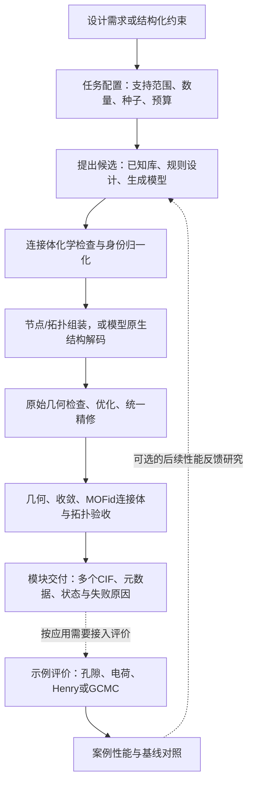

# 项目总览：AI 设计 MOF 模块

更新：2026-11-20。本文作为当前项目思路与状态的阅读入口；具体实验依据见文末。历史记录保存在 worklog.md，各批次的冻结协议和原始结果保持不变。

**最新交付：AI设计MOF模块v0.1已实现。** Python/命令行统一入口支持EGMOF默认模式、MOFFlow-2连接体探索、场景配置、任务状态、取消/超时、验证及候选包。两条真实小批各交付2份CIF，20项本地测试通过。使用见[mof_design/README.md](mof_design/README.md)，验收见[mof_design/ACCEPTANCE.md](mof_design/ACCEPTANCE.md)。

**11月20日最新状态：** 新一轮9项功能验收全部通过，EGMOF与连接体探索各生成并交付2个候选。已在本地增加任务报告和面向研究人员的材料档案/批次对比，20项模块测试及3项报告测试通过。统一阅读入口见[module_delivery/local_snapshot_20261120/INDEX.html](module_delivery/local_snapshot_20261120/INDEX.html)。本地报告源码已集成；旧wheel和服务器发布快照保留原版，浏览器视觉复核与新版本发布待推进。

## 1. 最终目标与当前问题

最终目标是：**实现一个可调用的AI设计MOF模块，接收设计需求或结构化约束，调用受支持的生成路线，返回多个候选CIF及其来源、验证状态和失败说明。** 模块的输入、输出、支持范围与任务状态应清晰一致，能够接到现有工作流中使用。

SiH₄中痕量CO₂分离是目前已有评价资产支持的**应用验证案例**。其中的选择性、容量和产品损失用于检验该案例，主要计算工况为298 K、1 bar、CO₂摩尔分数0.001、SiH₄余量。案例结果独立保留；它不决定模块只能服务这一种分离任务。

模块验收首先检查：统一任务入口、受支持约束的正确传递、可复现的候选生成、化学/结构/身份检查、多个CIF与元数据交付、任务状态与失败处理，以及现有评价管线的可选衔接。具体应用中的性能提升和命中密度，另作为该应用的研究指标。历史文档中的分离命中率标准继续用于对应案例。

生成与验证底座已有多轮试验，现已封装第一版统一模块入口、任务编排和候选交付。条件/吸附对照作为独立应用验证归档。下一步按实际设计需求补场景适配与使用体验，训练和深入某个分离案例分别决定。

## 2. 整体工作链

图中区分模块主流程与可选应用评价。v0.1已统一结构化任务入口、编排和候选包交付；自然语言解析和网页界面尚未实现，按需要叠加。当前预训练场景为已有CO₂性质模型，泛化到其他气体或性质需对应资产和验证。

## 3. 已完成工作的脉络

| 工作层 | 做了什么 | 已得到的证据 | 当前作用 |
|---|---|---|---|
| 评价底座 | 规则候选、已知库、代理/适用域、Widom/GCMC、过程和力场对照 | 历史737个GCMC及60个过程条件、32个力场敏感性任务完成 | 复用评价管线及历史基线 |
| 三引擎比较 | MOFDiff、MOFFlow-2、EGMOF各千样本 | 在各自CIF子集内，最终几何有效425/720、427/754、659/751；按原始1000条为42.5%、42.7%、65.9% | EGMOF在本批结构有效产率上领先；各路线保留独立角色 |
| 身份与新颖性 | 构筑块集合比对、StructureMatcher、从CIF运行MOFid | MOFFlow-2训练参考187047条已处理，171978条完整身份、15069条部分解析 | 把连接体、框架、参考库与覆盖缺口分开报告 |
| 连接体—框架组合 | 模型提出连接体，固定节点/拓扑重新组装 | 移除额外20°硬拒绝后的消融和独立批次结果支持保留更多可组装连接体 | 建立当前组合生产路线 |
| 同预算姿态比较 | 30个冻结连接体：单起点300步，对照两个起点各150步 | 严格通过26/30与28/30；双起点每有效框架墙钟成本约+61% | 固定单构象为默认，双构象保留质量/成本选项 |
| 精修敏感性 | 26个既有候选及8条诊断分支，阈值0.2→0.05 | 26/26收敛并保留身份；体积变化中位−7.33%；失败分支新增救回0 | 下游采用统一精修条件 |
| 条件与性能对照 | 目标2/5×两个配对种子，共2400序列、29种抽样连接体 | 24种有效候选，96/96双种子Henry/GCMC完成、审计通过 | 得到当前路线的实际目标响应与性能标签 |

三引擎千样本的“几何有效”口径与组合试验的严格连接体/拓扑验收口径不同，分别保留。历史737任务是另一批规则设计/已知库对照，当前96任务是条件生成组合路线，批次和门槛在引用时明确标注。

## 4. 三个引擎与当前生产路线的关系

| 路线 | 在项目中的角色 | 当前取舍 |
|---|---|---|
| EGMOF | 性质/描述符驱动构筑块与拓扑组合，提供结构产率基线 | 本批结构有效产率较高；吸附优势需用项目指标单独比较 |
| MOFFlow-2 | 生成金属/有机构筑块序列，提供连接体候选和条件接口 | 当前主线采用其连接体，接固定节点/拓扑组装 |
| MOFDiff | 粗粒化结构生成、构筑块匹配与全原子组装 | 保留不同结构生成路径；组装与结构缺陷仍是改进重点 |
| 规则设计/已知库 | 可控基线、历史标签和验证对象 | 继续作为成本与性能对照 |

**目前实际验证的组合是MOFFlow-2连接体生成＋固定pcu/Zn₄O组装＋MACE优化＋独立性能计算。** EGMOF与MOFDiff仍为独立基线/后续候选路线。各引擎按明确接口结合，后续逐个验证增益。

当前结构处理：构象种子7，先MACE变胞BFGS、广义力阈值0.2、最多300步，再从写出CIF以0.05最多追加300步；各阶段1200秒。最终同时记录优化收敛、几何与MOFid严格身份。达到停止阈值确认本轮局部优化终态；形成能、分解稳定性和实际合成仍需相应证据。

## 5. 最新条件对照告诉了我们什么

模型的目标2/5是**原生CO₂工作容量条件的输入数值**，其精确单位/工况仍待来源核对。项目要求的是SiH₄/CO₂分离表现，因此本轮也在检查跨指标迁移效果。

| 生成种子 | 目标 | 当前连接体规则合格序列/600 | 抽样种类 | 最终收敛且严格通过 |
|---|---:|---:|---:|---:|
| 1601 | 2 | 4 | 4 | 3 |
| 1601 | 5 | 118 | 15 | 11 |
| 1602 | 2 | 1 | 1 | 1 |
| 1602 | 5 | 112 | 15 | 13 |

每组按身份哈希抽最多15种，低目标不足时全取，没有补采样。跨组共享身份只算一次：35条组成员对应29种连接体，得到24种有效候选。同种子跨目标的合格连接体身份交集均0，条件信号已经影响候选提出环节。兼容率对应本项目单连接体类型、二羧酸和固定组装路线。

| 两个生成种子合并、按唯一身份统计 | 目标2 | 目标5 |
|---|---:|---:|
| 最终有效候选 | 4 | 20 |
| Henry选择性中位数 | 0.890 | 0.832 |
| 混合GCMC选择性中位数 | 0.867 | 0.848 |
| 混合选择性最佳值 | 0.968 | 1.641 |
| 混合选择性>1 | 0/4 | 5/20 |

S_CO2=(q_CO2/q_SiH4)/(y_CO2/y_SiH4)，大于1表示相对偏好CO₂。每种结构的两个模拟种子先取均值，再计算候选间统计。目标5有更好的个例，整体中位数未提高；低目标只有4种，当前为小规模描述性证据。

历史筛选的联合门槛为S_CO2≥2、q_SiH4≤1.5 mol/kg、q_CO2≥0.001 mol/kg。**用这套历史标准回看，本批24种候选为0/24通过，全部首先受S_CO2<2限制。** 这是整理时追加的历史标准参照，本轮预登记主要结果仍按原协议保留；5个S>1候选可用于性能诊断。

## 6. 当前能力、缺口与下一步

已有能力已封装为可统一配置、调用、追踪和返回结果的v0.1模块。两模式共用验证和交付，分开登记各自原生条件与支持范围。控制端不加载大模型，推理使用runtime配置的现有环境；当前真实模型验收在服务器进行，本地不自动下载权重。

v0.1已完成下列前三项，第四项作为按需扩展：

1. **定义模块输入输出。** 输入包括设计约束、生成路线、数量、随机种子和预算；性能目标按引擎实际支持范围标明。输出包括候选CIF、来源、唯一ID、验证状态、失败原因和批次清单。
2. **封装一条已验证路线。** 先统一当前连接体→固定节点/拓扑→精修→验收的调用方式，显式说明pcu/Zn₄O与二羧酸等范围；其他引擎作为可扩展适配器。
3. **补齐任务与交付流程。** 统一任务状态、进度、异常、日志、结果目录和候选包。用小批端到端验收证明从配置到多CIF返回可执行，不重复大型评价试验。
4. **把应用评价作为可选插件。** SiH₄/CO₂保留已有数据和接口，按需求调用；案例的性能反馈、DAO-P和更复杂引导列为扩展研究，分别确定投入。

目前实验验证没有执行条件，模块以可调用能力、可复查候选与适用范围交付。更广节点/拓扑覆盖、自然语言交互、合成与工艺验证按需求逐步扩展。某一分离案例未达到历史门槛，不据此判定整个模块交付失败。

## 7. 文件与阅读顺序

| 想看什么 | 阅读入口 |
|---|---|
| 当前目标、工作脉络、主要结论 | 本文PROJECT_OVERVIEW.md |
| 接手做什么、避免重复哪些任务 | NEXT_STEPS.md |
| 时间线、决策和运行偏差 | worklog.md |
| 可展开的模块、依赖与证据 | generation/project-workbench.html；项目根目录“打开项目工作台.cmd” |
| 历史性能基线 | generation/pilot_selection/exhaustive/REPORT.md |
| 三引擎千样本统一比较 | worklog.md的2026-11-13汇总；generation/structure_quality/ |
| 30样本同预算比较 | generation/budget_confirmation/PHASE_CLOSEOUT.md |
| 精修依据 | generation/convergence_sensitivity/REPORT.md |
| 最新条件与吸附对照 | generation/conditional_response/REPORT.md及results/performance/ |
| DAO-P备选检查清单 | generation/DAO_CANDIDATE.md |

26个B系列精修候选与本轮24个C系列条件对照候选来自不同试验，按各自批次统计。96项研究计算已完成；模块小批验收使用独立task ID与候选包，不并入该研究样本。
